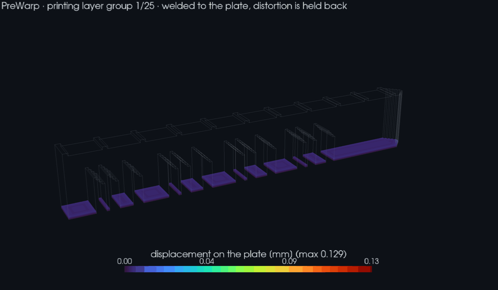
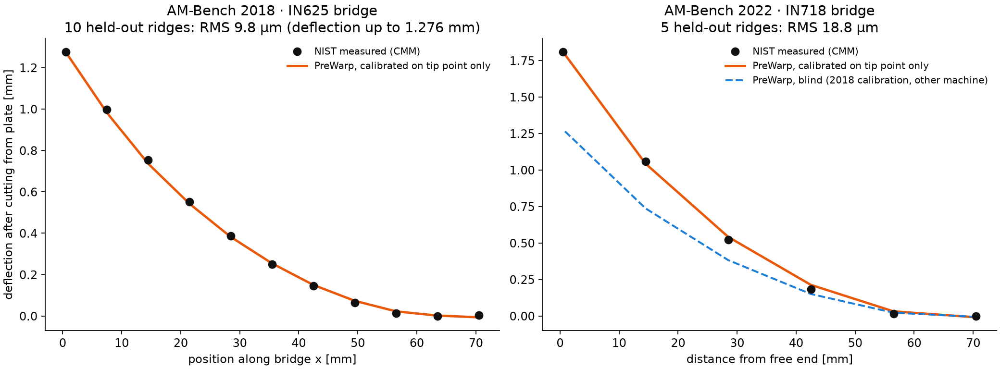
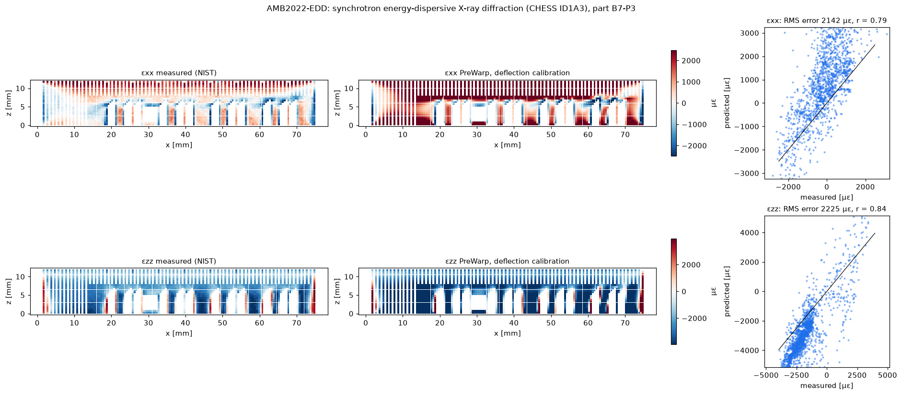
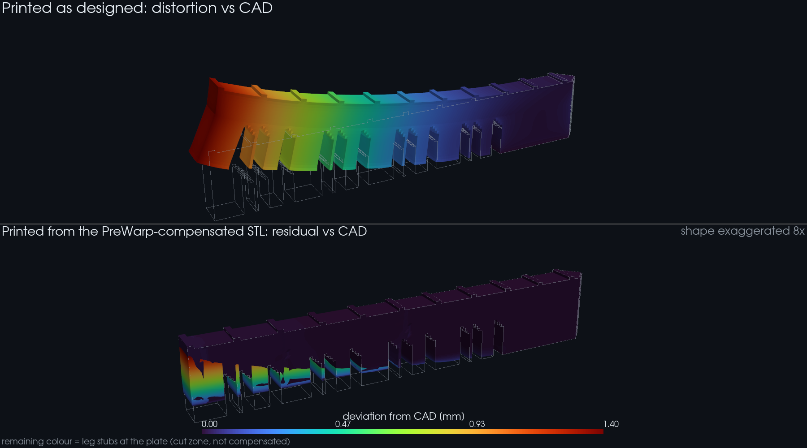
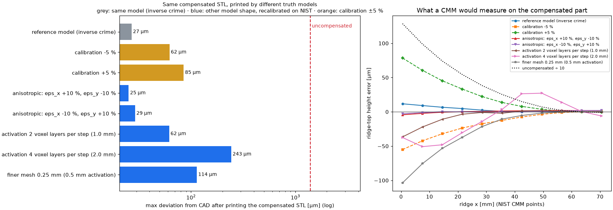
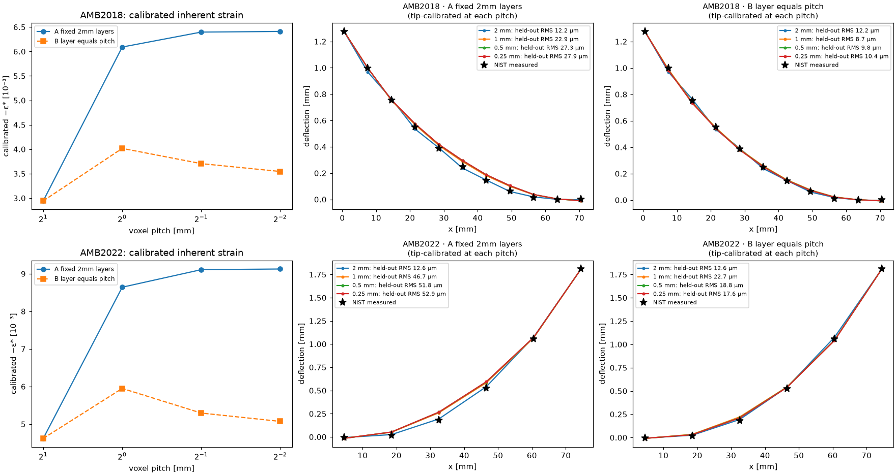

# PreWarp

**Predict how a metal 3D-printed (LPBF / SLM) part will warp, then pre-warp the CAD so it prints true.**
An inherent-strain finite-element engine, validated against NIST AM-Bench measurements, with
an MCP server and a Claude agent on top.



| | |
|---|---|
| **Accuracy** | Calibrated on **one** measured point, predicts the other 10 points of the NIST AMB2018-01 IN625 bridge with **9.8 µm RMS** (deflection up to 1.276 mm), and the 5 held-out ridges of the AMB2022-01 IN718 bridge with **18.8 µm RMS** (up to 1.809 mm). |
| **Compensation** | Writes a pre-deformed STL. On the NIST bridge (max distortion 1.39 mm), printing the compensated STL with a ±5 % calibration error leaves 0.06–0.09 mm (**−94 %**). Across model assumptions it is **−83 % to −98 %**: the compensated STL is judged by seven truth models that differ from the one that produced it. |
| **Speed** | ~25 s for the full layer-by-layer build and plate-cut simulation (110k DOF) on a consumer PC. |
| **LLM layer** | MCP server (works in Claude Desktop and Claude Code) + a Claude agent whose answers pass a **numeric grounding check**: every number must trace back to solver output. |

---

## Why

In laser powder-bed fusion every layer melts, solidifies and shrinks against the colder
metal below it. Residual stress builds up, the part distorts during the build, and it
springs back again when it is cut off the build plate. Shops pay for this with scrap, extra
machining stock, or commercial simulation licences.

PreWarp does the two things that actually save a print:

1. **Predict** the distortion and residual stress field of an STL before printing.
2. **Compensate**: produce a pre-deformed STL that, after printing and springback, lands
   on the nominal geometry.

## Validation against NIST AM-Bench



NIST printed bridge-shaped artifacts, cut their legs off the plate with wire EDM and measured
the deflection of the top ridges with a CMM. PreWarp simulates the exact NIST CAD
layer by layer, then the cut.

| Benchmark | Protocol | Result |
|---|---|---|
| AMB2018-01 · IN625 · EOS M270-class | 1 parameter fitted to all 11 points | RMS **7.8 µm**, max 11.7 µm |
| | calibrated on the tip point only → other 10 points | RMS **9.8 µm**, max 18.3 µm |
| AMB2022-01 · IN718 · NIST AMMT | calibrated on the tip point only → other 5 ridges | RMS **18.8 µm**, max 30.0 µm |
| | **blind**: 2018 calibration, different alloy, machine and process | tip **−29 %** |

How to read this honestly:

- Inherent strain is a **process** parameter. It has to be calibrated once per machine,
  alloy and parameter set, which is what the one-point protocol does. After that, the
  *shape* of the distortion is pure physics prediction.
- The blind cross-machine row shows what happens without calibration: −29 % at the tip.
  PreWarp is **not** compared with the AM-Bench challenge entries: they predicted blind from
  process parameters, PreWarp calibrates on a measured point, so the comparison would not be
  like for like.
- Compensation results are **model predictions**. The real test is printing the
  compensated STL, which is the next step.

Reproduce everything with `uv run python scripts/validate_nist.py` (≈3 min). The results are in
[`docs/results/validation.json`](docs/results/validation.json).

### Independent check: residual elastic strain (where the model falls short)

Deflection is what PreWarp is calibrated on, so it cannot be its only test. NIST also measured
the lattice strain inside as-built bridges still attached to their build-plate section, by
synchrotron X-ray diffraction (2018 and 2022) and by neutron diffraction (2018). With the
deflection calibration **unchanged**, PreWarp predicts those strains as follows. Each prediction
is averaged over the diffraction gauge volume, and no parameter is refitted.



| Data (NIST) | Points | Component | RMS error | Bias | Correlation r | Slope pred/meas |
|---|---|---|---|---|---|---|
| AMB2022-01 IN718, synchrotron EDD | 2088 | εxx | 2142 µε | +1554 µε | 0.79 | 1.56 |
| | | εzz | 2225 µε | −1277 µε | 0.84 | 1.61 |
| AMB2018-01 IN625, synchrotron EDXRD | 2125 | εxx | 1615 µε | +1273 µε | 0.79 | 1.35 |
| | | εzz | 1515 µε | −933 µε | 0.88 | 1.53 |
| AMB2018-01 IN625, neutron (1.5 mm gauge) | 204 | εxx / εyy / εzz | 1862 / 674 / 1822 µε | +1577 / −181 / −1334 µε | 0.69 / 0.67 / 0.34 | 1.48 / 1.11 / 0.38 |
| *Floor: NIST neutron vs NIST EDXRD, same part* | 160 | εxx / εzz | 413 / 1050 µε | +84 / +445 µε | 0.82 / 0.53 | – |

Both measured parts were still attached to their build-plate section (B7-P3 in 2022, the
sectioned 2018 bridge), so the comparison uses the simulated state **before the cut**: as
built, on the plate. The springback after cutting is not involved.

**Conclusion.** The pattern matches without refitting (AMB2022: r = 0.79 for εxx, 0.84 for εzz;
AMB2018 synchrotron: 0.79–0.88). The magnitude comes out 1.5–1.6× too high (slope of predicted
on measured, AMB2022; 1.35–1.53 for AMB2018). That is consistent with a linear-elastic model
without plasticity: in 76 % of the AMB2022 gauge volumes the predicted stress exceeds the
alloy's yield strength (68 % for AMB2018), which a real part cannot sustain. The model gets the
compressive legs, the tensile leg edges and the tensile top layers, and overshoots their level.
Adding plasticity (J2) is future work.

Details:

- **The measurement's share of the bias.** NIST took the stress-free lattice spacing d0 from two
  ~3.5 mm coupons cut from an identically built artifact and assumed it uniform over the part. It
  states about 100 µε total strain uncertainty, d0 included. A wrong d0 shifts *every* strain
  component by the same amount, so it can only explain the part of the bias common to εxx and
  εzz. The best common offset is +138 µε for AMB2022 (+170 µε for the AMB2018 EDXRD, +21 µε for
  the neutron data), about what NIST states. After removing it, εxx is still +1416 µε and εzz
  −1416 µε off. Opposite signs cannot come from a uniform d0. A d0 that varies across the part
  (chemistry, near-plate dilution) is not quantified in the NIST documents and remains possible.
- **One linear ε\* cannot match both deflection and stress.** Fitting ε* to the strains alone
  would give 0.33–0.47 of the deflection-calibrated value. The deflection calibration absorbs the
  plastic relaxation into one effective ε*.
- **Largest errors in the first 2 mm above the plate** (εzz bias down to about −3000 µε). The
  model welds the part to a rigid plate. The real plate section is compliant, yields locally,
  and relaxed when it was cut out of the full build plate.
- **ε_z does nothing in this formulation.** A layer deposited on a free top surface shrinks
  vertically without restraint, so ε_z leaves exactly zero elastic strain (there is a unit test
  for this). Neither deflection nor diffraction data can identify it.
- **Agreement between measurement techniques (AMB2018, same part).** NIST neutron and EDXRD
  differ by 413 µε (εxx) and 1050 µε (εzz) RMS, partly because their gauge volumes differ.
- **Not used:** NIST also measured the AMB2022 bridges by neutron diffraction (HFIR) and the
  contour method, but the public dataset (mds2-2711) contains only the CHESS synchrotron results.

**Consequence:** PreWarp's stress output is a qualitative map of where stress concentrates, not a
number to design against. `analyze_part` says so in every result. Distortion is the validated
output. Reproduce with `uv run python scripts/validate_residual_strain.py`. Results are in
[`docs/results/residual_strain.json`](docs/results/residual_strain.json).

## Compensation



```bash
uv run prewarp compensate part.stl -m IN718
# -> part_prewarp_compensated.stl + compensation.png + result.json
```

PreWarp iterates `x ← x − (x + u(x) − x_nominal)` on the node coordinates and re-simulates the
whole build on the morphed mesh every iteration. A pre-deformed part does not distort like the
original one, so one correction is not enough:

| Iteration | Max deviation | RMS |
|---|---|---|
| 0 (printed as designed) | 1.394 mm | 0.545 mm |
| 1 | 0.064 mm | 0.023 mm |
| 2 | 0.005 mm | 0.8 µm |
| 3 | 0.004 mm | 0.6 µm |
| **Independent check**: final STL re-sliced and re-simulated from scratch | **0.027 mm** | **5 µm** |

Details that matter here:

- **The machine slices the pre-deformed part horizontally.** Its voxel rows are no longer
  horizontal, so elements are activated by their real height, not their lattice index.
  Ignoring this leaves 0.084 mm of error on this part.
- **Layer assignment is discrete** (one activation layer = 0.5 mm). Re-assigning it every
  iteration made rows of elements jump between layers and the iteration stalled at 0.14 mm.
  So it is assigned on the first compensated shape and frozen. The independent re-slice check
  above shows what that costs: 3 µm becomes 27 µm.
- **No printing on powder.** At voxel level, a re-sliced 45° down-skin can end up touching
  finished material only along an edge. That acts as a hinge and gave a spurious 0.33 mm spike.
  Such patches are deferred to the next layer, as a real machine would.
### How good is it when the model is wrong? (no "inverse crime")

Checking a compensation with the model that produced it only shows that the iteration
converged. That is the 0.027 mm above. Here the compensated STL is also "printed" by seven
truth models that differ from it. The shape-changing ones are recalibrated on the same NIST tip measurement, so
each is as consistent with the data as the reference model.



| Truth model that "prints" the compensated STL | Max deviation | RMS | Ridge tops (CMM points) | Reduction |
|---|---|---|---|---|
| Same model (inverse crime, re-sliced) | 0.027 mm | 5 µm | ≤ 12 µm | −98.1 % |
| Calibration −5 % | 0.062 mm | 24 µm | ≤ 55 µm | −95.3 % |
| Calibration +5 % | 0.085 mm | 32 µm | ≤ 79 µm | −94.2 % |
| Anisotropic ε*: εx +10 %, εy −10 % (recalibrated) | 0.025 mm | 3 µm | ≤ 4 µm | −98.2 % |
| Anisotropic ε*: εx −10 %, εy +10 % (recalibrated) | 0.029 mm | 5 µm | ≤ 3 µm | −97.9 % |
| **Finer mesh**: 0.25 mm voxels, 0.5 mm activation (recalibrated) | 0.114 mm | 40 µm | ≤ 104 µm | **−91.8 %** |
| Coarser activation: 1.0 mm per step (recalibrated) | 0.062 mm | 18 µm | ≤ 37 µm | −95.5 % |
| **Coarser activation: 2.0 mm per step** (recalibrated) | 0.243 mm | 110 µm | ≤ 51 µm | **−83.1 %** |

How to read it:

- **Calibration error is the realistic headline: −94 % at ±5 %.** The residual scales with the
  error, about 0.06–0.09 mm for 5 % on this bridge.
- **The −83 % comes from the crudest truth model.** It lumps four voxel layers into each
  2 mm activation step, where the real machine deposits 20–40 µm layers. Recalibrated, it still
  reproduces the uncompensated deflection. The pre-deformed part, though, is tilted by up to
  1.4 mm, and slicing it into 2 mm slabs moves whole rows of elements from one step to the next.
  That changes the build history much more than in the finer models. Its maximum is not on the
  measured ridges, which stay within 51 µm. This row is a pessimistic stress test, not the
  expected result.
- **A finer truth model is more realistic, and it gives −92 %.** Its residual is a smooth 8 %
  over-compensation at the tip (−104 µm on the ridge), shrinking toward the attached end. The
  uncompensated prediction is mesh-converged (see *Mesh convergence*). The *response of the
  pre-deformed, horizontally re-sliced part* is not converged at 0.5 mm: at that resolution it
  changes the result by about 0.1 mm. Compensating directly on the 0.25 mm mesh would remove this
  term and needs about 20 GB of RAM per iteration.
- **Anisotropy matters little here** once recalibrated. The bridge is long in x, and recalibration
  on the tip absorbs most of the change.

[`scripts/compensation_robustness.py`](scripts/compensation_robustness.py) reproduces this
(resumable, one row at a time). Results are in
[`docs/results/compensation_robustness.json`](docs/results/compensation_robustness.json).

A 3 mm blend zone above the plate stays flat because the part is printed on a flat plate. The
compensated STL is the original surface morphed by the interpolated field, so it stays
watertight and keeps its CAD detail.

## Quickstart

```bash
git clone https://github.com/sals121/prewarp && cd prewarp
uv sync
uv run prewarp analyze data/nist/AMB2022-01-AMMT-PartCAD.STL -m IN718
uv run prewarp orient my_bracket.stl -m Ti6Al4V      # rank build orientations
uv run prewarp compensate my_bracket.stl -m Ti6Al4V
uv run pytest -q                                      # 65 tests: patch test, beam theory, physics, compensation, residual strain, grounding, MCP end-to-end
```

## LLM layer: an engineer you can talk to, that can't make numbers up

### MCP server

```bash
claude mcp add prewarp -e PREWARP_ALLOWED_DIRS=/path/to/parts -- uv --directory /path/to/prewarp run prewarp-mcp
```

or in Claude Desktop's `claude_desktop_config.json`:

```json
{ "mcpServers": { "prewarp": { "command": "uv", "args": ["--directory", "/path/to/prewarp", "run", "prewarp-mcp"],
                              "env": { "PREWARP_ALLOWED_DIRS": "/path/to/parts" } } } }
```

The model can only open `.stl` files inside `PREWARP_ALLOWED_DIRS` (see *Security*).

Tools: `analyze_part`, `compensate_part`, `rank_orientations`, `list_materials`, `nist_validation`.
Then just ask: *"This IN718 bracket warps at the tip. Which orientation is best, and give me a
compensated STL."*

### Claude agent with a grounding gate

```bash
export ANTHROPIC_API_KEY=...
uv run prewarp agent "Analyse examples/bracket.stl in Ti6Al4V and fix the distortion"
```

The agent (Claude Opus 5.5, tool runner, server-side refusal fallback) plans the workflow,
calls the solver and explains the result. Before the answer is shown,
[`prewarp/grounding.py`](src/prewarp/grounding.py) extracts every number from the text and
matches it against the tool outputs, allowing for rounding and mm↔µm or fraction↔% conversions.
If any number is unsupported, the agent gets the list back and one chance to fix it.
Anything still unsupported is flagged to the user.

**The LLM orchestrates and explains. The physics engine is the only source of numbers.**

## How it works

- **Method:** the inherent strain method (Ueda; Liang et al.), the approach behind commercial
  LPBF distortion tools. Each deposited layer carries a calibrated eigenstrain, and the part is
  activated bottom-up on a rigid plate.
- **FEM written from scratch** in vectorised numpy: 8-node hexahedra with **Wilson–Taylor
  incompatible modes** to avoid shear locking in bending (tested against beam theory within 3 %),
  plus a patch test for exact eigenstrain response.
- **Plate cut / removal** uses the exact internal forces of the incrementally built state,
  released at the cut nodes. A partial cut (legs only) or a full removal with best-fit
  alignment, like a CMM report, are both supported.
- **Calibration is linear algebra:** displacement is linear in the inherent strain, so the build
  is solved once per unit load case and calibration is least squares. The bridge data also
  shows that the vertical inherent strain has essentially no effect on this deflection
  (< 1e-10 mm per unit), so only the in-plane component is identifiable there.
- **Solver:** Intel MKL PARDISO via `pypardiso`, about 2 s per 125k-DOF factorisation.
  SciPy's SuperLU took minutes because of fill-in. PreWarp falls back to SuperLU where MKL
  is unavailable.

### What the ablations say (AMB2018-01, same calibration)

| Change | Tip deflection | Best refit RMS |
|---|---|---|
| Reference: 0.5 mm voxels, one activation step per layer | — | 7.8 µm |
| 1.0 mm voxels | −6.6 % | 7.4 µm (in 1.9 s) |
| 6 lumped activation steps | −39 % | 22 µm |
| Single step (whole part at once) | **−96 %**, wrong shape | 219 µm |
| Standard hex8 (no incompatible modes) | +0.07 % (thick sections; matters for thin walls) | 7.5 µm |

Layer-by-layer activation is the physics. Activate everything at once and the bending
disappears. Calibrated inherent strains are tied to the activation layer thickness (0.5 mm here).

### Mesh convergence

Both bridges, voxel pitch 2.0 → 0.25 mm, ε* recalibrated on the tip at every resolution, the
other points held out. Two studies separate the two things a "mesh" changes here:

- **A, fixed 2 mm activation layers:** only the spatial discretisation changes.
- **B, activation layer = voxel pitch** (the production setting): the activation thickness
  changes too.



| Bridge · study | Pitch | Unit tip response | Calibrated −ε* | Held-out RMS |
|---|---|---|---|---|
| AMB2018 · A | 1.0 / 0.5 / 0.25 mm | −209.5 / −199.5 / −199.1 mm | 6.09 / 6.40 / 6.41 ×10⁻³ | 22.9 / 27.3 / 27.9 µm |
| AMB2022 · A | 1.0 / 0.5 / 0.25 mm | −209.3 / −198.6 / −198.2 mm | 8.64 / 9.11 / 9.13 ×10⁻³ | 46.7 / 51.8 / 52.9 µm |
| AMB2018 · B | 1.0 / 0.5 / 0.25 mm | −317.6 / −344.3 / −359.9 mm | 4.02 / 3.71 / 3.55 ×10⁻³ | 8.7 / 9.8 / 10.4 µm |
| AMB2022 · B | 1.0 / 0.5 / 0.25 mm | −304.1 / −341.7 / −356.6 mm | 5.95 / 5.29 / 5.07 ×10⁻³ | 22.7 / 18.8 / 17.6 µm |

**The 0.5 mm headline is converged.** Refining the production setting (study B) from 0.5 to
0.25 mm moves the AMB2022 held-out RMS from 18.8 to 17.6 µm (−1.1 µm) and the AMB2018 one
from 9.8 to 10.4 µm (+0.6 µm); no recalibrated prediction point moves by more than 2.7 µm.
The headline accuracy holds to about 1 µm at twice the resolution.

**How this table relates to the headline accuracy.** Every row uses the same protocol as the
headline: ε* calibrated on the tip point only, the same NIST points held out (10 on AMB2018,
5 on AMB2022) and the same ridge probe. The headline numbers *are* the study B rows at 0.5 mm:
9.8 µm and 18.8 µm, with the same ε* to 12 digits. **Study A is not comparable with the
headline**: it lumps four 0.5 mm voxel layers into each 2 mm activation step, a deliberately
cruder physics model. Its 52.9 µm at 0.25 mm measures that model, not a finer version of the
headline.

**Why the study A error rises as the mesh is refined (46.7 → 51.8 → 52.9 µm on AMB2022).**
Same protocol and the same activation thickness, so this is a fair question. It is the mesh
error going away and revealing the error of the 2 mm model, not divergence:

- The converged residual is systematic. Both bridges are over-predicted mid-span (+85 µm at
  x = 32.5 mm on AMB2022, +46 µm at x = 35.5 mm on AMB2018) with the shape flattened toward
  the tip. Thick activation steps distribute the bending wrongly along the bridge.
- At 1 mm voxels part of this is cancelled by discretisation error of the opposite sign
  (+77 instead of +85 µm at the worst point).
- The changes shrink geometrically: 5.1 then 1.1 µm in RMS (ratio ≈ 4.6, about second order
  for hex8), so the RMS extrapolates to about 53 µm. On both bridges no point moves by more
  than 9.4 µm from 1.0 to 0.5 mm, or 2.0 µm from 0.5 to 0.25 mm.
- With 0.5 mm activation (study B) the same points stay within 30 µm (AMB2022) and 18 µm
  (AMB2018), and the AMB2022 mid-span over-prediction drops from +83 to +30 µm.

**Study B also rises slightly on AMB2018 (8.7 → 9.8 → 10.4 µm).** There the activation layer
thins with the mesh, so the physics changes too. The residual shifts smoothly: at x = 7.5 mm,
near the tip, it goes −9.0 → −15.1 → −17.1 µm, steps of 6.1 then 2.0 µm. Extrapolating the
RMS trend gives roughly 11 µm in the limit, against the 9.8 µm headline at 0.5 mm. That is a
real, small sensitivity to the activation thickness, and it is disclosed here rather than
absorbed into the headline. On AMB2022 the same study moves the other way, 22.7 → 18.8 →
17.6 µm, so the 0.5 mm headlines are neither flattered nor penalised by more than about 1 µm
at 0.25 mm.

What it shows:

- **The FE discretisation is converged.** With the physics held fixed (A), going from 0.5 to
  0.25 mm voxels changes the tip response by 0.2 % on both bridges.
- **In production (B) the calibrated *prediction* converges, the calibrated ε\* does not have
  to.** ε\* is an effective parameter tied to the activation thickness, as in every
  inherent-strain code (real layers are 20–40 µm). It moves about 4 % from 0.5 to 0.25 mm on both bridges,
  while the recalibrated deflection curve moves at most 2.4 µm (AMB2018) and 2.7 µm (AMB2022),
  against 6.1 and 8.6 µm from 1.0 to 0.5 mm.
- **Thin activation layers are physics, not a numerical detail.** At a converged mesh, 2 mm
  layers fit the measured shape 2.7–3.0× worse than 0.25 mm layers (27.9 vs 10.4 µm RMS on
  AMB2018, 52.9 vs 17.6 µm on AMB2022).
- The 2 mm voxel row is in the JSON but not in the table. With the legs a few voxels thick its
  unit response is about 2× off (−392 to −433 mm), and its low held-out RMS (12–13 µm) is fortuitous.
- The finest production run, AMB2022 at 0.25 mm (234k elements, 787k DOF, 50 activation
  steps), took 12 min with a 19.2 GB memory peak.

[`scripts/mesh_convergence.py`](scripts/mesh_convergence.py) reproduces this (resumable).
Results are in [`docs/results/mesh_convergence.json`](docs/results/mesh_convergence.json).

## Security

The MCP server and the agent take file paths from a language model, and a model can be
steered by text it reads (prompt injection). PreWarp therefore treats those paths as untrusted.

**What the path validation protects** (MCP and agent; the CLI is not restricted, there you
type the path):

- The model can only open existing `.stl` files inside `PREWARP_ALLOWED_DIRS`
  (`os.pathsep`-separated; default: the working directory). It cannot read other files.
- Network and device paths are refused on the text alone, before anything touches the
  filesystem: UNC (`\\host\share`, `//host`), `\\?\` and `\\.\` prefixes, URLs, drive- and
  root-relative paths (`C:part.stl`, `\part.stl`), alternate data streams (`a.txt:b.stl`) and
  device names (`NUL`, `CON`, `COM1`…). Even resolving a UNC path makes Windows authenticate
  to the remote host and can leak the user's NTLM hash.
- The path is then made absolute without touching the disk and must already lie inside an
  allowed folder, compared folder by folder and case-insensitively on Windows, so `C:\parts`
  does not admit `C:\parts-other\x.stl`. Nothing outside is ever resolved: even resolving a
  mapped network drive (`Z:\x.stl`) would contact its server.
- Inside the allowed folder the path is walked one folder at a time. A symlink or junction
  is followed only after its target, read without following it, passes the same checks, so a
  link to a network share or to a folder outside is refused.

**Resource limits** (every entry point, checked before loading, voxelising and simulating).
Solver memory grows faster than linearly with the element count, about 20 GB at 234k
elements, so a huge STL or a tiny voxel pitch could exhaust the machine:

| Variable | Default | Limits |
|---|---|---|
| `PREWARP_MAX_STL_MB` | 100 | STL file size |
| `PREWARP_MAX_ELEMENTS` | 100 000 (≈ 8 GB) | hexahedral elements |
| `PREWARP_MAX_GRID_CELLS` | 20 × element limit | voxel grid, checked before it is allocated |
| `PREWARP_MAX_TRIANGLES` | 2 000 000 | STL triangles, and the triangles a non-watertight STL is subdivided into before voxelising |

A part over a limit fails with an error that names the variable to raise.

**Remaining risk (requires local access):** someone who can write to an allowed folder could
swap a folder for a link pointing to a network path between the check and the moment the STL
is opened (a race). The allowed folders themselves come from your configuration and are
trusted, so do not point `PREWARP_ALLOWED_DIRS` at a network share. Both need local write
access to the machine, which is outside what this validation defends against. Keep
`PREWARP_ALLOWED_DIRS` to folders only you write to.

## Limitations

- The model is linear-elastic and has no plasticity or thermal history. That is standard for
  inherent strain, and a calibration covers a machine, alloy and parameter set.
- Because of that, residual stress is a qualitative map: the pattern matches NIST diffraction
  data, the magnitude is 1.5–1.6× too high (see the residual strain section). Distortion is
  the validated output.
- The build plate is rigid. The real plate section is compliant and yields locally.
- Validated on one geometry family (the AM-Bench bridges, two alloys and machines). The
  compensation is a simulation result; no compensated part has been printed and measured yet.
- Only the in-plane inherent strain is identifiable from the bridge data. The vertical
  component has no effect in this layer-activation formulation (see the residual strain section).
- Calibrated alloys: IN625 (AMB2018 process) and IN718 (AMB2022 process). The others use
  literature-typical values and are flagged as uncalibrated in every result.
- Supports are not generated. Parts with floating regions are rejected with a clear error.
- Voxel meshes stair-step slopes. Use `--pitch` to trade accuracy for speed.

## Data and credits

NIST AM-Bench geometry and measurements: **Credit: NIST**. See
[`data/nist/README.md`](data/nist/README.md) for DOIs and the publications the measurement
values come from (Phan et al. 2019; Praniewicz, Fox & Tarr 2023).

## License

MIT
